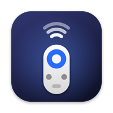

<h1 align="center">AirRoom Remote</h1>

Control your Google TV, Android TV or projector from your computer. 
Runs on <b>Mac</b> and <b>Windows</b>.

<a href="https://github.com/Latrixz/airroom-remote-release/releases/latest"><b>Download</b></a> · macOS 15 or later · Windows 10 or 11

---

- Remote buttons, swipe pad, mouse mode and your computer's keyboard
- Type, paste and edit text on the TV
- Voice search with your computer's microphone
- Open, install, update and uninstall TV apps
- Turn the TV on over the network
- Updates itself

**Mac:** download the `.dmg`, open it and drag AirRoom Remote to Applications.
**Windows:** download `AirRoomRemote-Setup-….exe` and run it (or use the portable `.zip`).

This repository only holds the downloads and the update feeds.
